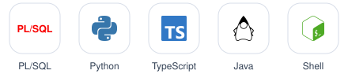
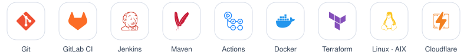
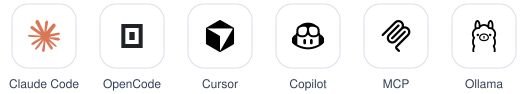

  <picture>
    <source media="(prefers-color-scheme: dark)" srcset="assets/banner-dark.svg">
    
  </picture>

Je conçois et développe des traitements de données pour des mutuelles santé chez **Cegedim Insurance Solutions**, à Toulouse : des batchs **Oracle SQL / PL-SQL** qui traitent des millions de lignes, de l'analyse du besoin jusqu'à la mise en production. Je suis aussi le **référent outillage IA** de mon équipe. En dehors du travail, je construis des applications web et des outils autour des agents IA.

## Expérience

**Cegedim Insurance Solutions** · Toulouse · secteur assurance santé

| Poste | Dates | Stack |
|---|---|---|
| **Ingénieur concepteur** | sept. 2024 – aujourd'hui | Oracle SQL / PL-SQL, Unix / AIX, GitLab CI, Jenkins |
| **Alternant ingénieur développeur** | oct. 2021 – août 2024 | Java / JavaFX, Oracle, migration de données |

- Conception de batchs Oracle qui traitent des millions de lignes par exécution, avec analyse des lenteurs et optimisation.
- Lancement de l'outillage IA de l'équipe, utilisé chaque jour par 13 développeurs : une quarantaine de skills, agents et règles partagés, et 2 serveurs MCP.
- Automatisation de la livraison : environ 30 minutes d'étapes manuelles remplacées par une seule validation humaine.
- Audit qualité SQL et documents d'analyse générés automatiquement, pour des livrables plus fiables et moins d'allers-retours avec les clients.
- Pendant l'alternance : migrations de données, développements spécifiques et un outil interne de gestion clients en Java / JavaFX.

## Projets personnels

<table>
  <tr>
    <td width="180"><b><a href="https://cuisines-delaurent.fr">cuisines-delaurent.fr</a></b> en production</td>
    <td>Site vitrine d'un artisan agenceur. Il remplace un ancien WordPress : plus rapide, testé et déployé automatiquement. Astro · TypeScript · Tailwind CSS · Vitest · Playwright · GitHub Actions</td>
  </tr>
  <tr>
    <td><b>Portail locatif</b></td>
    <td>Portail web de gestion locative pour un usage familial. Next.js · PostgreSQL · Prisma · Docker · Terraform</td>
  </tr>
  <tr>
    <td><b>Coach-Bot</b></td>
    <td>Coach sportif et plan alimentaire générés par un LLM qui tourne en local. Python · FastAPI · Ollama · Cloudflare Pages</td>
  </tr>
</table>

## Boîte à outils

<table>
  <tr>
    <td><b>Langages</b></td>
    <td>
      <picture>
        <source media="(prefers-color-scheme: dark)" srcset="assets/stack-langages-dark.svg">
        
      </picture>
    </td>
  </tr>
  <tr>
    <td><b>Données</b></td>
    <td>
      <picture>
        <source media="(prefers-color-scheme: dark)" srcset="assets/stack-donnees-dark.svg">
        
      </picture>
    </td>
  </tr>
  <tr>
    <td><b>Web</b></td>
    <td>
      <picture>
        <source media="(prefers-color-scheme: dark)" srcset="assets/stack-web-dark.svg">
        
      </picture>
    </td>
  </tr>
  <tr>
    <td><b>Livraison</b></td>
    <td>
      <picture>
        <source media="(prefers-color-scheme: dark)" srcset="assets/stack-livraison-dark.svg">
        
      </picture>
    </td>
  </tr>
  <tr>
    <td><b>IA</b></td>
    <td>
      <picture>
        <source media="(prefers-color-scheme: dark)" srcset="assets/stack-ia-dark.svg">
        
      </picture>
    </td>
  </tr>
</table>

## Workflow agentique

Je travaille chaque jour avec des agents de code : **Claude Code** en principal, **[OpenCode](https://github.com/sst/opencode)** (que j'utilise et auquel j'ai contribué), Cursor et Copilot dans l'IDE, **Ollama** pour les LLM en local, et **2 serveurs MCP** que j'ai écrits en TypeScript.

Les plugins et skills que je garde installés :

<table>
  <tr>
    <td width="50%"><a href="https://github.com/obra/superpowers"><b>Superpowers</b></a> Brainstorming, plan, tests d'abord, développement piloté par sous-agents</td>
    <td width="50%"><a href="https://github.com/multica-ai/andrej-karpathy-skills"><b>Karpathy Skills</b></a> Règles de code tirées des notes d'Andrej Karpathy</td>
  </tr>
  <tr>
    <td><a href="https://github.com/DietrichGebert/ponytail"><b>Ponytail</b></a> Le plus petit changement qui règle vraiment le problème</td>
    <td><a href="https://github.com/JuliusBrussee/caveman"><b>Caveman</b></a> Réponses courtes, moins de tokens</td>
  </tr>
  <tr>
    <td><a href="https://github.com/thedotmack/claude-mem"><b>claude-mem</b></a> Une mémoire qui suit d'une session à l'autre</td>
    <td><a href="https://github.com/pbakaus/impeccable"><b>Impeccable</b></a> Vocabulaire de design pour peaufiner et critiquer une interface</td>
  </tr>
  <tr>
    <td><a href="https://github.com/nextlevelbuilder/ui-ux-pro-max-skill"><b>UI UX Pro Max</b></a> Design system et bonnes pratiques UX</td>
    <td><a href="https://github.com/Leonxlnx/taste-skill"><b>Taste</b></a> Direction artistique et goût visuel pour le front</td>
  </tr>
</table>

Au travail, j'ai monté un socle partagé de skills, sous-agents, règles et hooks, synchronisé automatiquement sur Claude Code, Cursor et OpenCode et vérifié par une CI. Les agents préparent l'analyse et le code, et une validation humaine reste obligatoire avant toute action sensible.

## Formation

- **Master Informatique**, parcours Réseaux et objets connectés · CNAM · 2024, en alternance
- **Licence Informatique** (L3) · CNAM · 2022
- **BTS Systèmes numériques**, option informatique et réseaux · 2021
